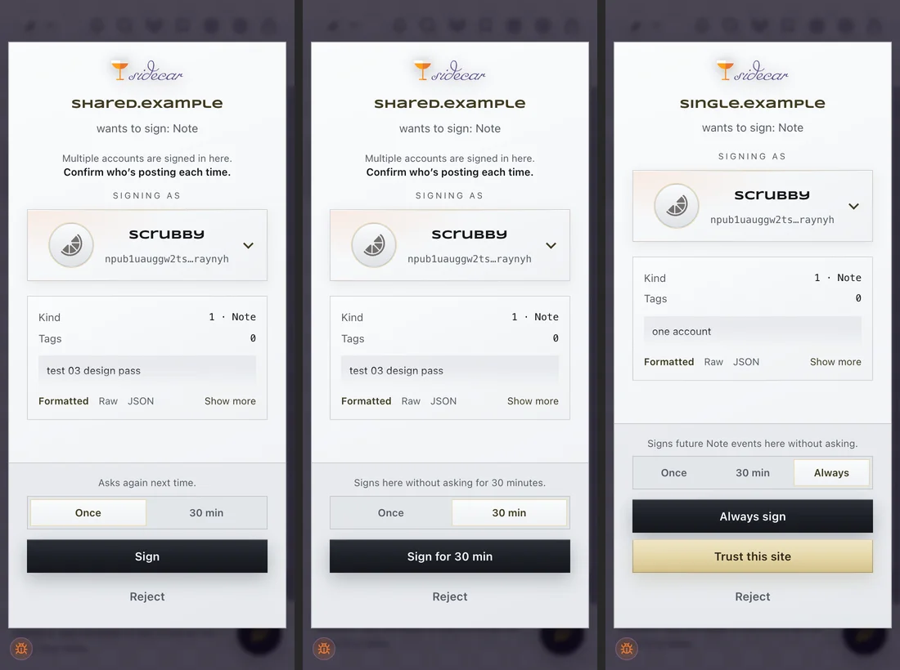
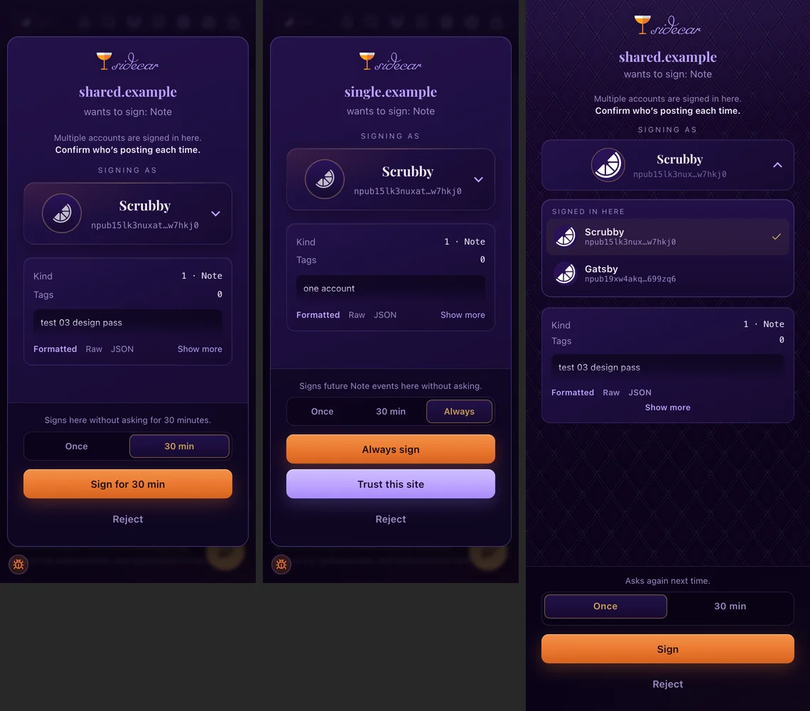

# PR evidence: the approval card’s scope row, tested case by case

The approval card now asks one question in one row: **Once · 30 min · Always**, plus Sign and Reject. This records every scenario that was tested against that design, on both approval surfaces (the side panel and the popup window), and what each one showed. The lab that ran them ships with this pull request at `test/manual/approval-lab.html`, so any case here can be rerun.

Tested on November 8, 2026: an automated run of all 25 cases (rerun after the last fix) in a clean Chrome profile with two throwaway accounts, then a pass by hand in Chrome, including on jumble.social. **All 25 cases pass.**





## How the lab works

- **Two hosts.** Sidecar keeps windows, grants and signed-in accounts per host, so the one-account cases run on `single.localhost` and the two-account cases on `shared.localhost`. Chrome resolves every `*.localhost` name to the machine itself.
- **Every request is timed.** An answer in under a second cannot have been a person tapping a card, so the page scores “signed without asking” and “asked” by itself, and records which account signed each event.
- **Signs, never publishes.** No profile, follow, mute or trust-list event (kinds 0, 3, 10000, 10040) is ever signed, so the overwrite guard’s baselines are never touched.
- **The automated run** drove the real extension in headless Chrome through the panel’s own controls and messages: the scope segments, Sign, Reject, the account menu, the status bar’s Restart and End, lock and unlock, and the Activity tab’s grant removal. Each case’s on-card expectations (segments shown, the line above the row, button label, bar, badge, widths) were read from the live page.

## Results

Times are from the automated run. “No card” means the request was answered in about 0.01 s.

### 1 · One account: Once and the 30-minute window

| Case | What it checks | Result |
|---|---|---|
| 1.1 | Log in; the button reads Allow once, since a login is not a signature | Pass |
| 1.2 | Once signs one note and asks again. The row shows Once · 30 min · Always, as wide as the Sign button, under “Asks again next time.”; the button reads Sign; Trust is offered | Pass: both notes answered by card |
| 1.3 | 30 min opens the window: the line reads “Signs here without asking for 30 minutes.”, the button “Sign for 30 min”; the bar and badge appear | Pass: bar at 29:59, badge 30; three more notes signed with no card |
| 1.4 | The window does not cover a never-relax kind (a wallet-control event, kind 23194) | Pass: card shown mid-window, with no scope row and the button still reading Sign |
| 1.5 | The window covers an encrypt | Pass: no card |
| 1.6 | Restart and End | Pass: Restart put the window back to 30:00 from under 29:00; End removed the bar and cleared the badge; the next note asked |
| 1.7 | An encrypt card’s wording | Pass: Once · 30 min, no Always; “Allow once”, then “Allow for 30 min” |
| 1.8 | A choice never carries over to the next card | Pass: after a 30-min pick was rejected, the next card started on Once with “Sign” |
| 1.9 | A burst of three becomes one batch card | Pass: one “Allow all (3)” card with no scope row; one tap signed all three |
| 1.10 | Locking ends the window | Pass: bar gone after unlock; the next note asked |
| 1.11 | The account capsule opens the menu, on a host where only one account is signed in | Pass: chevron on the capsule, no separate link; menu shows “Signed in here” and “Other accounts”; a second tap closes it |

### 2 · One account: Always

| Case | What it checks | Result |
|---|---|---|
| 2.1 | Always covers one kind, and only that kind | Pass: “Signs future Reaction events here without asking.”, “Always sign”; two more reactions with no card; a note still asked |
| 2.2 | Removing the grant in Activity brings the card back | Pass |
| 2.3 | Always on a named record covers that record only | Pass: “Signs future versions of “lab-a” here without asking.”; lab-a again with no card; lab-b asked |

### 3 · The popup card

| Case | What it checks | Result |
|---|---|---|
| 3.1 | The popup matches the panel, and its 30-minute choice opens the window | Pass: same row, line and button; the panel showed the bar afterwards |
| 3.2 | The popup hides what it does not offer | Pass: no scope row on a wallet-control event, and the button reads Sign, as in the panel |
| 3.3 | The popup’s account menu opens | Pass: both groups shown; the capsule is the switch |

### 4 · Two accounts on one site

| Case | What it checks | Result |
|---|---|---|
| 4.1 | Sign in with both accounts | Pass |
| 4.2 | The multi-account card: “Multiple accounts are signed in here.” over a bold “Confirm who’s posting each time.”; Once · 30 min only; no Trust; the menu lists both | Pass: signed as the active account |
| 4.3 | A 30-minute window for one account | Pass: bar shows that account; three notes signed with no card, as that account |
| 4.4 | Picking the other account in the card signs as it | Pass: the capsule changed, the card stayed open, signed as the picked account, which became active |
| 4.5 | Two windows at once, with Settings → Auto-sign timers → Keep a timer for each account on | Pass: a window for each account, both running after the switch between them; the bar shows the active account’s with a +1; a note as either account signed with no card |
| 4.6 | Restart and End with two windows | Pass: started from two windows; End cleared the bar and the badge; the next note asked |
| 4.7 | The default, one account at a time: switching ends the window | Pass: B’s window ended when Sidecar switched to A; the next note asked |
| 4.8 | The default: a window for A ends B’s | Pass: a note naming A got a card despite B’s window; after A’s 30 min, only A’s window was running and the bar showed A with no +1 |

## One signing account at a time, unless you ask for more

By default only one account signs without asking at a time. Switching Sidecar’s account ends every window, posting on a site as another account ends that site’s, and opening a window for one account ends any other account’s (4.7, 4.8). Two accounts each able to sign without asking is how a multi-account client’s slot mix-up goes out under the wrong account with no card; with one window, a note naming the other account still gets a card.

**Settings → Auto-sign timers → Keep a timer for each account** turns that off: each account keeps its own window through a switch (4.5, 4.6). The status bar shows the active account’s window, or the one that ends first when the active account has none, and its Restart button and the badge follow the same window. A +N capsule on the bar opens a list of the other windows, each with its time left and its own end button. Turning the setting back off leaves only the active account’s windows. Windows always end on lock, when the site is forgotten, and when a site is detached from the wrong identity.

## Bugs the lab found, all fixed here

1. **The panel’s 30 min and Always never took effect.** The scope row’s radio inputs had no ids, so the card’s lookups found nothing: the render stopped partway, and Sign always signed once. This was the “asks every time” report.
2. **Picking an account under “Signed in here” in the panel canceled the request.** Every row in the merged menu detached the site, because each row read a flag that flipped after the first group was built.
3. **The popup’s account menu never opened.** It called an `el()` helper that `prompt.js` does not have.
4. **The popup showed segments it does not offer.** `.seg label { display: flex }` outranked its `.hidden`, so Always appeared on multi-account cards and 30 min could appear on an overwrite warning.
5. **On a host with one account signed in, the panel’s menu could not be opened,** so “Other accounts” was unreachable there; the popup allowed it.
6. **A scope choice could carry over to the next card.** It now resets per card, and an incidental redraw of the same card keeps the pick.
7. **A hidden 30-minute radio could turn “Allow all” into a window** in the panel; only a segment the card shows now counts, as in the popup.
8. **The two surfaces labeled the button differently.** A sign card with no scope row (an overwrite warning, a wallet-control kind) read “Allow once” in the panel and “Sign” in the popup, and a popup login card offered to “Sign”. Both now say Sign on a sign card and Allow once on anything else.

## Tests added

- `test/page-ids-exist.test.js`: every `$('id')` in the panel, popup, composer and highlight scripts names an element that exists. Fails on bug 1.
- `test/composer-core.test.js`: the popup now gets the same check for undeclared names the panel has. Fails on bug 3.
- `test/wrong-account-escape.test.js`: runs the panel’s real menu builder and clicks its rows. Fails on bug 2.
- `test/relax-grant.test.js`: windows coexist per site and account, and are listed soonest-first.
- `test/relax-survives-switch.test.js`: runs the account switch, the site rebind, the window grant and the settings change from `background.js` under both settings, then runs the panel’s bar with three windows: it names the active account, Restart and the badge pick the same window, and +N lists the other two, also after closing and reopening.

## What the automated run could not cover

- Headless Chrome cannot open popup windows, so the run opened the popup page for each queued request directly. Chrome opening the window itself is left to a pass by hand.
- Layout was checked from page measurements and in two themes (Speakeasy and Werkstätte), not by eye in every theme.

## Rerunning it

```sh
python3 -m http.server 8021        # from the repo root
open http://single.localhost:8021/test/manual/approval-lab.html
open http://shared.localhost:8021/test/manual/approval-lab.html
```

Load Sidecar unpacked with two test accounts and the side panel open, and work down the page. Each case says what to do and what to expect, and a Report button copies every verdict and request log.
